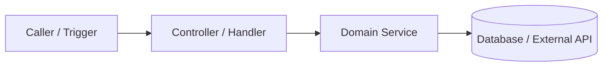

# Skill: Teaching, Deep-Learning & Developer Onboarding (Enterprise Edition)

> **Load When:** Operating in `phases/phase_teach.md` — teaching a developer or architect how a domain, service, data model, or framework works.

---

## Lesson Template (5 Progressive Layers)

```markdown
# Deep-Dive Lesson: <Domain / Subsystem Name>

## 1. Why It Exists & Mental Model
- **Business Problem Solved:** <1–2 sentences>
- **Core Concepts:** <3–5 key terms defined in plain language>

## 2. Visual Architecture & Data Flow


## 3. Guided Code Walkthrough (The Red Thread)
1. **Entry Point (`symbolName()`):** <Explanation + Durable Deep Link (`~L20`, `_Verified: YYYY-MM-DD._`)>
2. **Core Business Logic (`symbolName()`):** <Explanation + Durable Deep Link>
3. **Data Model (`table_name`):** <Key columns, constraints, and state transitions>

## 4. Common Pitfalls & Gotchas (From `MASTER_MEMORIES.md`)
| Trap | Why It Fails | Correct Repo Pattern |
|---|---|---|
| ... | ... | ... |

## 5. Try It Yourself & Next Steps
- **Safe Read-Only Probe:** `<SELECT query or CLI command>`
- **Next Drill-Down Options:** 1. <Option A> · 2. <Option B> · 3. <Save to `./docs/wiki/<domain>.md`>
```
